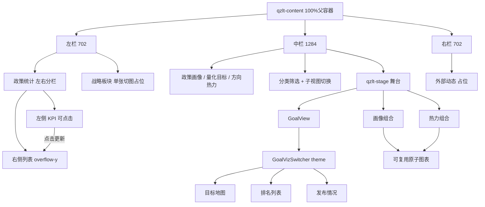

# 全战略态势内容区：方案 C 双尺寸适配

## 锁定决策

- **不做**整页 `transform: scale`（避免 1920 上下留白、文字发糊）
- **以 2880 为设计基准**写结构与视觉 token；1920 视为同一套 UI 的压缩态
- 组件只认父容器：`width/height: 100%`，不写死 `100vh`（头文件外置、方便移植）
- 图表统一用项目已有的 **ECharts 5**
- 首期先搭**壳子 + 三栏 + 中间 Tab 舞台切换**；各图可用静态 mock，后续再接真数据
- **【战略板块】约定**：左栏下方「战略板块」内部**不做复杂 DOM/流程图还原**，统一用**一张切图**铺满该区域占位；**切图目前尚未提供**。实现时预留 ``（或背景图）位与资源路径（如 `src/asset/images/sys/`），切图未到前用灰色/半透明占位块撑住布局，切图到位后只替换资源即可
- **目标运行环境以 Windows 为主**（约 90% 展示机；开发机可为 Mac）。验收与微调以 Windows + Chrome/Edge 为准；字体栈优先 Windows 常见中文字体（如 `"Microsoft YaHei", "PingFang SC", sans-serif`），避免只在 Mac 上看着合适；滚动条、字重、发虚感以 Win 实机为准，Mac 仅作开发预览
- **图表组件化（可复用）**：雷达、地图、排名条、发布柱状、热力矩阵等**每种图表单独成组件**，通过 props 收数据、根节点铺满父级并自管 `resize`；本页的 `PortraitView` / `GoalView` 等只做组合与筛选，不把 ECharts 逻辑写死在页面里。目录放在可被其他 sys 页引用的位置（见下）
- **【量化目标切换】完整复用**：`【目标地图】【排名列表】【发布情况】` 三态切换 + 对应三张图，封装为**独立组合组件**（含二级 Tab/按钮与舞台），其他页面可整段引用；**禁止**把切换逻辑只写在本页 `GoalView` 里
- **风格主题兼容**：同一套组合/图表须支持至少两套视觉——本页 **深色科技风（dark）**；他页 **白底浅色（light）**。通过 prop（如 `theme="dark" | "light"`）切换，图表配色、坐标轴/标签色、Tab 选中态、面板边框均跟 theme，避免写死大屏青色描边导致白底不可用
- **【左上政策统计】约定**：区域内左右分栏——**点击左侧 KPI/分类项，更新右侧列表的数值（及对应条目）**；右侧条数可多于一屏可见条数，列表容器必须 `overflow-y: auto`（父级限高 + `min-height: 0`），滚动条样式兼顾 Windows
- **F11 / 浏览器全屏**：必须支持反复进出全屏而不「弄坏」布局。方案 C 按**父容器真实宽高**弹性填充 + `ResizeObserver` 更新 `--qzlt-s`，不依赖整页 `transform: scale`，全屏只改变可用高度/宽度时三栏与舞台应跟着伸展，而不是整页错位或留巨大黑边
- **【右侧外部动态】约定**：右侧栏内容有调整、细则未定——**本期只做线框占位**（标题区 + 空内容区/占位块，保持 702 宽与面板样式），**不做**日期筛选、标签圆钮、动态列表的精细还原与交互；后续定稿再补

## 适配机制（方案 C 核心）

在 [`QuanzhanlvetaishiContent.vue`](src/pages/sys_page/sys_quanzhanlvetaishi/components/QuanzhanlvetaishiContent.vue) 根节点挂 `ResizeObserver`：

- 设计宽 `DESIGN_W = 2880`
- `scale = clamp(容器宽 / 2880, 0.67, 1)`（1920 → ≈0.67，2880 → 1）
- 把 `scale` 写成 CSS 变量，例如 `--qzlt-s`，再派生：
  - `--qzlt-gap`、`--qzlt-pad`、`--qzlt-font-sm/md/lg`、`--qzlt-radius` 等
- 布局用 **flex 百分比/弹性**，尺寸用 **这些变量**，不用整页缩放

三栏线框宽度（**2880 设计稿标注**，指面板/线框本身，不含栏间距）：

| 区域           | 设计稿宽度 |
| -------------- | ---------- |
| 左栏           | **702px**  |
| 中栏（舞台区） | **1284px** |
| 右栏           | **702px**  |

水平尺寸关系（2880 画布）：

- 三栏线框：`702 + 1284 + 702 = 2688px`
- **栏间距（左-中、中-右）各 16px**，共 `32px`（实现：`gap: calc(16px * var(--qzlt-s))` 或等价 token `--qzlt-col-gap`）
- 剩余外边距：`2880 - 2688 - 32 = 160px` → 左右外边距合计 160px（对称则各约 **80px**，随 `s` 缩放）

实现比例：

- 三栏按 `702 : 1284 : 702` 分配；容器 `display:flex; gap: var(--qzlt-col-gap)`
- 随 `--qzlt-s`：左/中/右视觉宽约 `702*s` / `1284*s` / `702*s`；1920 下约 `s≈0.67` → **468 / 857 / 468**，间距约 **11px**
- 中栏 `min-width: 0`，热力过密时在舞台内横滑

高度：`.qzlt-content` 已是 `flex:1`（见 [`styles/index.scss`](src/pages/sys_page/sys_quanzhanlvetaishi/styles/index.scss)）；内部三栏 `height:100%`，左右上下两块用 flex 分高，中间舞台 `flex:1; min-height:0`。

### F11 全屏防抖约定

- 页面壳保持 `height:100vh; overflow:hidden`（已有），避免全屏切换时出现/消失纵向滚动条导致**宽度来回跳几像素**、布局抖一下
- `--qzlt-s` **只跟容器宽度走**（`width/2880` clamp）；高度变化只靠 flex 填满，不因 F11 多出的纵向空间去改字号比例，减少「一全屏字突然变大/变小」
- `ResizeObserver` 足够覆盖多数全屏尺寸变化；可额外听 `fullscreenchange` / `resize` 做一次 token 与图表 `resize` 的兜底刷新（防个别浏览器 RO 时机不准）
- 禁止用 `100vw` 算布局宽（含滚动条时与 `100%` 不一致，进出全屏更易抖）
- 验收：窗口最大化下连续 F11 开/关数次，三栏比例与间距稳定，图表不裁切、不错位

## 组件拆分

### 本页布局（`sys_quanzhanlvetaishi/components/`）

- [`QuanzhanlvetaishiContent.vue`](src/pages/sys_page/sys_quanzhanlvetaishi/components/QuanzhanlvetaishiContent.vue) — 三栏壳 + ResizeObserver 写 CSS 变量
- `LeftPanel.vue` — 上：政策统计；下：战略板块切图位
- `PolicyStatsBlock.vue`（或内嵌于 LeftPanel）— **左 KPI + 右列表**；维护 `activeKey`，点击左侧切换右侧 `list` 数据源；右侧 `.qzlt-stats-list { flex:1; min-height:0; overflow-y:auto }`
- `RightPanel.vue` — 外部动态（**仅占位壳**，内容待调）
- `CenterPanel.vue` — 主 Tab + 筛选 + 舞台
- `center/PortraitView.vue` / `GoalView.vue` / `HeatmapView.vue` — **只组合**筛选与图表组件，不含图表内部实现
- [`styles/index.scss`](src/pages/sys_page/sys_quanzhanlvetaishi/styles/index.scss) — 本页布局与面板样式

### 可复用层（`src/pages/sys_page/charts/`，与业务页解耦）

**原子图表**（`props: { data, theme }`）：

- `RadarChart.vue` — 政策画像雷达
- `ChinaMapChart.vue` — 目标地图
- `RankBarChart.vue` — 排名横向条
- `ReleaseBarChart.vue` — 发布情况柱状
- `DirectionHeatmap.vue` — 方向热力矩阵

**组合组件（他页会整段复用）**：

- `GoalVizSwitcher.vue`（名称可微调）— 内含二级切换【目标地图 | 排名列表 | 发布情况】+ 下方舞台；`v-model`/`active` 控制当前态；组装 `ChinaMapChart` / `RankBarChart` / `ReleaseBarChart`；透传 `theme`、`data`（或分图 data）
- 本页 `center/GoalView.vue` **只引用**该组合组件（可再包一层本页筛选：一级/二级分类），不重复实现三态切换

约定：

- 根节点 `width/height:100%`，自管 `resize`
- 样式自包含，**不**依赖 `.qzlt-page`；theme 用根 class（如 `.sys-chart--dark` / `.sys-chart--light`）+ ECharts option 内按 theme 取色板
- light：白/浅灰底、深色文字、常规描边；dark：透明/深底、浅色文字、青色高亮（对齐本大屏）

页面壳 [`index.vue`](src/pages/sys_page/sys_quanzhanlvetaishi/index.vue) / 头部不改职责。

## 左上政策统计交互

1. 布局：左（若干 KPI/分类卡片）| 右（明细列表）
2. 点击左侧某一项 → 高亮该项 → 右侧列表绑定该分类下的条目与数值（mock 先按分类切换数组）
3. 右侧列表条数可超过可视区域 → **必须可纵向滚动**；滚动发生在列表容器内，不撑破左上卡片、不影响战略板块高度
4. Windows 下注意滚动条宽度占用，列表内容区预留或美化细滚动条，避免挤乱图标与数字对齐

## 中间舞台约定（多图切换通用）

1. `CenterPanel` 只维护 `activeMainTab`（画像 / 目标 / 热力），切换组合视图
2. 舞台 `.qzlt-stage`：`flex:1; min-height:0; overflow:hidden`
3. 组合视图引入独立图表组件；密度策略：
   - **疏图**（雷达、柱图、地图）：填满舞台
   - **密图**（热力）：列最小宽 + 字号下限；不够则**舞台内横向滚动**

## 视觉与资源

### 资源目录与重命名（开工第一步）

- 本页切图统一使用 [`src/asset/images/qzlts/`](src/asset/images/qzlts/)（约 38 张）
- **实现前批量重命名**：去掉文件名中的 `@2x`（及同类无效后缀），例如 `bg-main@2x.png` → `bg-main.png`；代码引用一律用去后缀后的路径
- 主要资源归类（重命名后）：
  - 背景：`bg-main.png`、`bg-mask-overlay.png`（page 壳优先用 `qzlts/bg-main`，可替代原 `sys/大背景@2x.png`）
  - 方向热力相关：`direction-heatmap.png`、`icon-heatmap.png`
  - 图标：`icon-*`、`chevron-*`、`logo-state-grid-lab.png`
  - 标签：`tag-*`
  - 占位：`placeholder-*`（体积很小，仅作位占）
- **战略板块**：仍按「单张切图」约定；若 `qzlts` 中尚无专用战略板块整图，继续占位，有图后只换路径（勿用 HTML 拼层级）
- 面板：半透明深底 + 青色描边/角标；图标优先用 `qzlts` 切图
- 数据一律 mock

### 重命名示例（全部 `*@2x.png` → `*.png`）

`bg-main`、`bg-mask-overlay`、`direction-heatmap`、`icon-book`、`icon-briefcase`、`tag-policy-blue`、`chevron-down`、…（目录内其余同规则）

## 验收标准

- 浏览器宽度 **2880** 与 **1920** 三栏铺满、无整页黑边
- 左上：点击左侧 KPI 右侧列表数值/条目切换；条目超高时仅右侧列表纵向滚动
- 主 Tab 切换正确；`GoalVizSwitcher` 可三态切换且他页可整段复用
- `theme=dark` 适合本大屏；`theme=light` 在白底上文字/轴/Tab 可读（可用临时白底容器自测）
- 原子图表可被他页单独 import；拖拽 resize 正常
- 1920 热力可读或可横滑；观感以 Windows 为准
- **反复 F11** 进出全屏，布局不跳动、不错位，图表正常 resize
- 内容组件可移植到固定高度父容器

## 实施顺序

1. **重命名** `qzlts/*@2x.png` → 去掉 `@2x`
2. Content 三栏壳 + CSS 变量缩放；背景接 `qzlts/bg-main`
3. 左上交互统计 + 战略板块占位 + 右栏线框占位（图标用 qzlts）
4. 中栏 Tab/筛选 + 空舞台
5. 原子图表 + `GoalVizSwitcher`（含 dark/light）
6. 三个组合视图接入；GoalView 引用 Switcher
7. 双尺寸 / F11 / Win / 双主题微调
